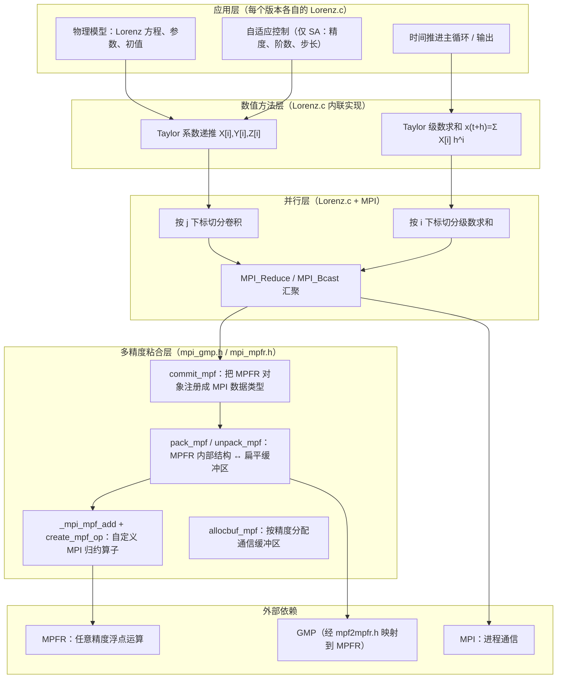

# CNS-code 项目架构分析

> 分析对象：本仓库 `master` 分支当前代码（2 个程序 + 2 个公共头文件，共约 2000 行）。
> 分析日期：2026-11-07。

## 1. 项目概览

本仓库实现了 **洁净数值模拟（Clean Numerical Simulation, CNS）** 在 Lorenz 混沌系统上的两个版本：

| 目录 | 对应工作 | 核心思想 |
| --- | --- | --- |
| `Code-Lorenz/` | Liao & Wang (2014) | **固定精度**：整个时间区间 [0, 10000] 使用固定的 3500 阶 Taylor 展开、固定步长 0.01、固定 4180 位十进制精度 |
| `Code-Lorenz-SA/` | Qin & Liao (2023) | **自适应精度（Self-Adaptive CNS）**：精度、Taylor 阶数、时间步长随当前时刻动态调整，在保证 `T_c = 10000` 可信的前提下大幅降低计算量 |

两个程序求解的是同一个问题：

```
dx/dt = σ (y - x)
dy/dt = R x - y - x z
dz/dt = x y - b z
```

参数 σ = 10，R = 28，b = 8/3；初值 (x, y, z) = (-15.8, -17.48, 35.64)；求解区间 t ∈ [0, 10000]（Lorenz 时间单位）。

CNS 的误差控制由三部分构成，代码结构也正好对应这三件事：

1. **时间截断误差** → 高阶（数千阶）Taylor 级数展开；
2. **舍入误差** → 所有变量/参数用 MPFR 多精度浮点表示；
3. **计算规模** → MPI 多进程并行（卷积与级数求和都做并行分解）。

## 2. 目录结构

```
CNS-code/
├── README.md                  # 项目背景、论文引用、两个程序的说明
├── docs/
│   └── architecture.md        # 本文档
├── Code-Lorenz/               # 固定精度版
│   ├── Lorenz.c               # 主程序（182 行）
│   ├── mpi_gmp.h              # MPI + GMP/MPFR 粘合层：接口与全局声明（233 行）
│   ├── mpi_mpfr.h             # 粘合层实现：打包/解包/自定义归约算子（499 行）
│   ├── makefile               # mpicc 编译
│   └── run.sh                 # mpirun -np 1200
└── Code-Lorenz-SA/            # 自适应精度版
    ├── Lorenz.c               # 主程序（367 行）
    ├── mpi_gmp.h              # 与 Code-Lorenz 中的同名文件完全一致
    ├── mpi_mpfr.h             # 与 Code-Lorenz 中的同名文件完全一致
    ├── makefile
    └── run.sh
```

两个目录中的 `mpi_gmp.h`、`mpi_mpfr.h` **逐字节相同**（已用 diff 确认），是两版程序共享的底层库。修改时应同步两个副本。

## 3. 分层架构



**职责边界**：`Lorenz.c` 只关心“算什么、何时输出、误差参数取多少”，完全不接触 MPFR 的内部字节布局；通信缓冲区的构造和自定义数据类型全部封装在两个头文件里。这是这套代码最值得保留的设计。

## 4. 物理模型与数值方法

### 4.1 Taylor 展开

在时刻 t 已知解 (x(t), y(t), z(t))，将解展开为步长 h 的 Taylor 级数：

```
x(t+h) = X[0] + Σ_{i=1..M} X[i] h^i
y(t+h) = Y[0] + Σ_{i=1..M} Y[i] h^i
z(t+h) = Z[0] + Σ_{i=1..M} Z[i] h^i
```

其中 `X[0], Y[0], Z[0]` 是当前时刻的解，`X[i], Y[i], Z[i]` 是第 i 阶 Taylor 系数。

### 4.2 Taylor 系数递推公式

将级数代入 Lorenz 方程，对比 t^{i-1} 的系数，得到（代码中的实际形式）：

| 方程 | 递推公式 | 代码位置 |
| --- | --- | --- |
| x′ = σ(y − x) | `X[i] = σ·(Y[i-1] − X[i-1]) / i` | `Lorenz.c` 中 `mpfr_sub`/`mpfr_mul_ui`/`mpfr_div_ui` 三段 |
| y′ = R x − y − x z | `Y[i] = (R·X[i-1] − Y[i-1] − (x z)_{i-1}) / i` | 同上 |
| z′ = x y − b z | `Z[i] = ((x y)_{i-1} − (b1/b2)·Z[i-1]) / i` | 同上 |

其中两个卷积项：

```
(x z)_{i-1} = Σ_{j=0..i-1} X[j] · Z[i-1-j]
(x y)_{i-1} = Σ_{j=0..i-1} X[j] · Y[i-1-j]
```

代码里分别对应 `DXZ`/`DXY`（固定版）与 `D2[0]`/`D2[1]`（SA 版）。注意 `b` 用整数 `b1=8, b2=3` 表示，递推中写成“先乘 8 再除 3”，避免引入 8/3 的表示误差——这是多精度计算中的常见技巧。

### 4.3 一个时间步的流程

```mermaid
sequenceDiagram
    participant R as 每个 MPI 进程
    participant Root as 0 号进程
    Note over R: 已知 X[0], Y[0], Z[0]
    loop i = 1 .. M（逐阶求系数）
        R->>R: 本进程负责 j ≡ myid (mod np) 的部分卷积
        R->>Root: MPI_Reduce（求和 DXZ、DXY）
        Root->>R: MPI_Bcast（广播卷积结果）
        R->>R: 用递推公式算出 X[i], Y[i], Z[i]
    end
    loop i = 1 .. M（逐项求级数和，各进程分片）
        R->>R: 计算 h^i · X[i] 等部分和
    end
    R->>Root: MPI_Reduce（求和 Mx、My、Mz）
    Root->>R: MPI_Bcast（广播步进增量）
    R->>R: X[0] += Mx; Y[0] += My; Z[0] += Mz
    Note over R: 完成一步推进 t → t + h
```

### 4.4 为什么这样能控制误差

- **截断误差**：Taylor 级数在 h 很小时收敛极快，取 M 阶后的截断误差约为 `|c_M| h^M` 量级。固定版用 M = 3500、h = 0.01；SA 版用 `tol = 10^{-N}` 反解 h。
- **舍入误差**：每一阶递推只做有限次四则运算，舍入误差随步数累积并被混沌放大。取 N 位十进制有效数字后，舍入误差约为 `10^{-N}`，在放大后仍远小于截断误差。
- **混沌放大**：Lorenz 系统的误差大致按 `10^{t/2.53}` 增长，即每单位时间损失约 `1/2.53 ≈ 0.395` 位十进制有效数字。这是 SA 版中常数 `2.53` 的来源（经验拟合值，仅对该参数下的 Lorenz 系统成立）。

## 5. 并行策略

核心观察：**每个时间步内，所有进程都要持有完整、完全相同的 Taylor 系数数组**。因此并行只发生在“求和”这一层，而不做数据分布存储。

### 5.1 计算分解

| 阶段 | 分解方式 | 每个进程的负载 | 通信 |
| --- | --- | --- | --- |
| 卷积 `(xz)_{i-1}`, `(xy)_{i-1}` | 对固定的阶 i，按 `j = myid, myid+np, ...` 切分 | O(i/np) | 每阶 2 次 Reduce + 若干 Bcast |
| Taylor 级数求和 | 对 `i = myid+1, myid+1+np, ...` 切分 | O(M/np) 项 | 每步 3 次 Reduce + Bcast |

### 5.2 数据复制

- `mpfr_t X[M+1] / Y[M+1] / Z[M+1]` 是**全局数组**，每个进程各有一份，初始化精度相同。
- 由于 Reduce 结果被广播回所有进程，每步结束时所有进程的 `X[i], Y[i], Z[i]` 数值**逐位相同**，不会因进程间舍入路径不同而分叉。这是 CNS 可重复性的重要保证。
- 代价：内存随进程数线性重复。固定版约 `3 × 3501 × 13886 bit ≈ 18 MB`；SA 版初始约 `3 × 10001 × 20000 bit ≈ 75 MB`（不含 MPFR 结构体开销）。

### 5.3 复杂度

- 单步计算量：`O(M² / np)`（卷积）+ `O(M² / np)`（级数求和，见 9.4 的优化说明）。
- 单步通信量：`O(M)` 次集合通信（固定版每阶 4 次：2 Reduce + 2 Bcast；SA 版每阶 3 次：2 Reduce + 1 次 2 元素 Bcast）。
- 固定版总步数固定为 10⁶（h = 0.01）；SA 版步长逐步自适应，步数不固定。SA 版比固定版快约 6 倍（37.2 h vs 220.9 h，见 README）的主要原因是**每步的 Taylor 阶数与有效位数随时间大幅下降**，单步开销显著减小。

## 6. 两套程序对比

### 6.1 总体对比

| 维度 | `Code-Lorenz`（固定） | `Code-Lorenz-SA`（自适应） |
| --- | --- | --- |
| 精度策略 | 全程 4180 位十进制（13886 bit） | 每 50 时间单位降低一次，4348 → 218 位十进制 |
| Taylor 阶数 | 固定 3500 | `MM = ceil(1.5 × PRE)`，6522 → 327 |
| 时间步长 | 固定 h = 0.01 | 每步按末阶系数自适应选取 |
| 终止条件 | `m <= H`（H = T/h，共 10⁶ 步） | `t > T_c`（Compare > 0） |
| 输出 | 每 1.0 时间单位；0 号进程写 MP 文件、1 号进程写 double 文件 | 每 1.0 时间单位；0 号进程同时写两个文件 |
| 步长与输出对齐 | 无（步长整除输出间隔） | 有：必要时截断步长以精确落在输出时刻 |
| 通信 | 每阶 2 Reduce + 2 Bcast（单值） | 每阶 2 Reduce + 1 Bcast（2 个值一起传） |
| 主程序行数 | 182 | 367 |

### 6.2 固定精度版（`Code-Lorenz/Lorenz.c`）

关键参数（文件开头 15–64 行）：

| 名称 | 值 | 含义 |
| --- | --- | --- |
| `prec` | 13886 | **MPFR 精度（bit）**，≈ 4180 位十进制（注释写的是 "number of significant digits"，实际单位是 bit） |
| `M` | 3500 | Taylor 展开阶数 |
| `h` | 0.01 | 固定步长 |
| `T` | 10000.0 | 总时长 |
| `out_T` | 1.0 | 输出间隔 |
| `a, b1, b2, c` | 10, 8, 3, 28 | σ, b = b1/b2, R |

主循环 `for(m=0; m<=H; m++)`，每步依次执行：输出 → 系数递推 → 级数求和 → 更新 `X[0], Y[0], Z[0]`。程序不做任何收敛性判断，完全依赖 README 中给出的参数组合（3500 阶 / 0.01 步长 / 4180 位）保证 `T_c = 10000`。

### 6.3 自适应精度版（`Code-Lorenz-SA/Lorenz.c`）

关键参数（文件开头 15–25 行）：

| 名称 | 值 | 含义 |
| --- | --- | --- |
| `T_c` | 10000.0 | 临界可预测时间 |
| `gamma` | 1.1 | 安全因子 |
| `delta_T` | 50.0 | 精度调整的时间间隔 |
| `out_T` | 1.0 | 输出间隔（要求 `delta_T/out_T` 为整数） |
| `remaining_T` | 500.0 | 当 `t > T_c - 500` 后不再降低精度 |
| `prec` | 20000 (bit) | 初始分配精度（≈6020 位十进制，留出余量） |
| `M` | 10000 | Taylor 系数数组的最大阶数 |

每 50 个时间单位（且 `t ≤ T_c - remaining_T = 9500`）执行一次精度调整（`Lorenz.c:129-196`）：

```
PRE = ceil( gamma · (T_c − t) / 2.53 )        // 十进制有效数字位数
MM  = ceil( 1.5 · PRE )                       // Taylor 阶数
tol = 10^(−PRE)                               // 允许的截断误差
bit精度 = round( PRE · log2(10) ) + 1         // 转换为 MPFR 的 bit 精度
```

含义：**在时刻 t 引入的 `10^{-PRE}` 量级噪声，经历剩余区间 `T_c − t` 的混沌放大后，到 `T_c` 时仍不会超过允许范围**。因此 `PRE` 随时间线性下降，而不是保持全程最高精度。

部分时刻的调度值：

| t | PRE（十进制位） | MM（阶数） | MPFR bit |
| --- | --- | --- | --- |
| 0 | 4348 | 6522 | 14445 |
| 50 | 4327 | 6491 | 14375 |
| 100 | 4305 | 6458 | 14302 |
| 500 | 4131 | 6197 | 13724 |
| 1000 | 3914 | 5871 | 13004 |
| 2000 | 3479 | 5219 | 11558 |
| 5000 | 2174 | 3261 | 7223 |
| 9000 | 435 | 653 | 1447 |
| 9500 | 218 | 327 | 726 |
| 9500 → 10000 | 218（保持不变） | 327 | 726 |

注意 `t = 9500` 时的 218 位远小于固定版的 4180 位——因为此后只剩 500 个时间单位，已经不需要更高的分辨率。这正是自适应策略节省算力的关键。

**自适应步长**（`Lorenz.c:198-294`）：每一步在系数算完后，用末两阶系数的量级估计允许步长：

```
tol   = 10^(−PRE)
Ym    = max(|X[MM−1]|, |Y[MM−1]|, |Z[MM−1]|)
YM    = max(|X[MM]|,   |Y[MM]|,   |Z[MM]|)

VSa = tol^(1/MM)      · Ym^(−1/(MM−1))
VSb = tol^(1/(MM+1))  · YM^(−1/MM)

h = min(VSa, VSb)
```

这是对“末项/首个略去项不超过 `tol`”的经验估计。步长每步重算，因此不再是 0.01。当 `t + h` 会越过下一个输出时刻时，把步长截断为 `h = t_next − t`，保证输出时刻精确（`Lorenz.c:296-306`）。

### 6.4 实现层面的主要差异

1. **通信批量化**：SA 版把 `D2[0]`、`D2[1]` 打包进一个 2 元缓冲区，用一次 Bcast 广播；固定版分别 Reduce/Bcast。SA 版还把 Reduce 后的解包限制在 0 号进程（`if(myid==0) unpack_mpf(...)`），减少其余进程的工作。
2. **输出归属**：固定版用 1 号进程专门写 double 参考解（`Lorenz.c:86-101`），若 `np < 2` 则不会产生该文件；SA 版由 0 号进程同时写两种文件。
3. **精度可变**：SA 版每次调整精度都会重新 `commit_mpf` 并重建 MPI 归约算子，并把 `X[0..MM]`、`Y[0..MM]`、`Z[0..MM]` 及所有标量 `mpfr_prec_round` 到新精度。固定版只注册一次。
4. **终止逻辑**：SA 版用 `Compare = mpfr_cmp(t, T)` 控制 `for(; Compare<=0; )` 循环；`Compare` 变量在步长选择中还临时用于比较，可读性较差但逻辑正确。

## 7. 关键实现细节

### 7.1 精度单位：bit vs 十进制位

这是读代码时最容易误解的地方：

- MPFR 的 `mpfr_set_default_prec()`、`mpfr_prec_round()`、`mpfr_init2()` 参数单位都是 **bit**。
- 固定版 `#define prec 13886` 注释写 "number of significant digits"，但 13886 bit ≈ 4180 位十进制，与 README 中的 4180 位一致，所以宏实际是 bit 数。
- SA 版区分得很清楚：`PRE` 是十进制位数，`PRE → bit` 的换算是 `round(PRE·log2(10)) + 1`。
- 输出格式 `"%.4180Re"`（固定版）/`"%.5000Re"`（SA 版）里的数字是**十进制有效数字位数**。

### 7.2 自定义 MPI 数据类型（`mpi_mpfr.h`）

MPI 不认识 `mpfr_t`，因此粘合层做了一套序列化：

1. **`commit_mpf()`（`mpi_mpfr.h:213-285`）**：按 MPFR 内部结构 `__mpfr_struct` 的布局构造一个 MPI struct 数据类型：
   - `_mpfr_sign`（int）
   - `_mpfr_prec`（long）
   - `_mpfr_exp`（long）
   - `_mpfr_d` 指向的 limb 数组（`_NUM_LIMB(a) = (prec−1)/GMP_LIMB_BITS + 1` 个 `unsigned long`）
   
   用 `MPI_UB` 把类型的上界设为 `get_bufsize_mpf()`，从而保证多个元素连续排列时的步长正确。
2. **`pack_mpf()` / `unpack_mpf()`**：直接 `memcpy` 上述字段，把对象展平成字节流再还原。
3. **`_mpi_mpf_add()` + `create_mpf_op()`**：注册为用户归约算子。算子回调里先 unpack 两个操作数，用 `mpf_add` 相加（`mpf2mpfr.h` 把 GMP 的 `mpf_*` API 映射到 MPFR），再 pack 回缓冲区。
4. **`allocbuf_mpf(prec, incount)`**：按 `get_bufsize_mpf × incount` 分配通信缓冲区。

需要注意的实现特征：

- 这套代码**直接依赖 MPFR 的结构体字段名和内存布局**（`_mpfr_sign`、`_mpfr_prec`、`_mpfr_exp`、`_mpfr_d`），不是公开 ABI，换 MPFR 大版本时可能失效。
- 类型映射表的字段顺序与 `pack_mpf` 的写入顺序并不一致（表里先 long 后 int，打包时先 int 后 long），但在 LP64 平台上两者总大小相同，且各块首尾相接、无空洞；MPI 只把该类型当作等长的字节块搬运，用户算子又按自己的布局解释缓冲区，所以实际能工作。这是一种**依赖巧合的脆弱实现**。
- 归约算子从缓冲区开头按 `int` 取精度（`_mpi_mpf_add` 中的 `itmp`），而缓冲区开头其实是 sign 字段；由于 `*datatype == MPI_MPF` 时走 `mpf_init`（默认精度）分支，这个错误值没有被使用。同样是脆弱点。
- 二进制序列化的可移植性有限：要求所有计算节点的字节序、`long` 宽度、GMP/MPFR 版本一致。

### 7.3 mpf2mpfr.h 的作用

`Lorenz.c` 同时包含 `gmp.h` 和 `mpfr.h`，并在包含自定义头之前 `#define _GMP_H` / `#define _MPFR_H` 抑制重复包含。`mpf2mpfr.h` 把 GMP 的 `mpf_t`/`mpf_*` 名称映射为 MPFR 的对应实现，因此粘合层里写的是 `mpf_init`、`mpf_add`、`mpf_clear`，实际执行的是 MPFR 运算。主程序则直接使用 `mpfr_*` API。

### 7.4 输出文件

| 文件 | 内容 |
| --- | --- |
| `XYZ_out-MP.dat` | 多精度解，每行 `t` + 4180（固定）/5000（SA）位十进制的 x, y, z |
| `XYZ_out-double.dat` | 同一时刻的双精度解，用于展示“双精度会失效”的对比 |
| `CPU.txt` | `run.sh` 重定向的全部 stdout/stderr，含每 50 时间单位的耗时与总耗时 |

两份 `.dat` 都以 `"a"`（追加）方式打开，**重复运行前必须手动删除旧文件**，否则数据会混在一起。

### 7.5 内存与循环细节

- `X/Y/Z` 是文件作用域的全局数组，在 `main` 中按 `m=0..M` 逐个 `mpfr_inits2`，程序结束时从未 `mpfr_clear`（进程退出即释放，可接受）。
- 固定版的 Taylor 求和循环对每个 i 重新从 1 连乘到 i 求 `h^i`（`Lorenz.c:139-152`），单步为 O(M²)；SA 版同样如此（`Lorenz.c:311-324`）。
- SA 版每次精度调整都重新 `allocbuf_mpf` 和 `create_mpf_op`，但没有释放上一轮的缓冲区和算子，属于内存/资源泄漏（对一次性长跑影响有限）。

## 8. 编译与运行

```bash
cd Code-Lorenz        # 或 Code-Lorenz-SA
make                  # 等价于 mpicc -o lorenz Lorenz.c -lgmp -lmpfr -lm
./run.sh              # 等价于 mpirun -np 1200 lorenz &> CPU.txt
```

依赖：

- C 编译器 + MPI（`mpicc`、`mpirun`）
- GMP 与 MPFR（`-lgmp -lmpfr`）

环境要求与注意事项：

- `mpi_gmp.h` 使用了 `MPI_Type_struct`、`MPI_Address`、`MPI_UB` 等 **MPI-1 时代的接口**。`MPI_UB` 在 MPI-3 中已被移除、`MPI_Type_struct` 已被弃用，较新的 MPI 实现可能无法编译。实际运行环境通常是 MPICH（或仍保留这些符号的 OpenMPI 配置）。
- `run.sh` 默认 `-np 1200`，在个人机器上需要改小。按 README，固定版 1200 核约需 220.9 小时，SA 版约 37.2 小时。
- 程序假定运行目录可写（输出文件直接写到当前目录）。
- 运行时内存按进程重复：固定版约 18 MB/进程，SA 版初始约 75 MB/进程。

## 9. 阅读与改进建议

### 9.1 正确性/可移植性风险

| 问题 | 位置 | 说明 |
| --- | --- | --- |
| MPI-1 接口 | `mpi_mpfr.h:262-277` | `MPI_Type_struct`/`MPI_Address`/`MPI_UB` 已弃用/移除，建议改为 `MPI_Type_create_struct` + `MPI_Type_create_resized` |
| 依赖 MPFR 内部结构 | `mpi_mpfr.h` 全文 | 直接访问 `_mpfr_prec`/`_mpfr_d`，跨 MPFR 版本/ABI 不安全 |
| 类型映射与打包布局不一致 | `mpi_mpfr.h:227-270` vs `pack_mpf` | LP64 下大小恰好相等才成立 |
| `_GET_PREC` 取错字段 | `mpi_gmp.h:55-58`、`mpi_mpfr.h` 的 `_mpi_mpf_add` | 从缓冲区开头按 int 取值，实际取到的是 sign；当前分支未使用，属潜在隐患 |
| 头文件中的全局定义 | `mpi_gmp.h:69-139` | 多个翻译单元包含会产生重复符号；目前每程序只有一个 `.c` 文件所以无事 |
| 精度单位注释易误导 | `Lorenz.c:15` | `prec` 是 bit 不是十进制位 |
| 资源泄漏 | `Lorenz.c-SA:192-196` | 精度调整时未释放旧缓冲区、未 `MPI_Op_free`、未 `MPI_Type_free` |
| 输出文件追加写 | 两个 `Lorenz.c` | 重跑前需清理 `.dat`，否则结果混杂 |
| 可重复性依赖进程数 | MPI Reduce 的归约树 | 不同 `np`/实现的求和顺序不同，末位可能不同；在误差预算内不影响物理结论，但严格 bit 级复现需固定 `np` 与 MPI 实现 |

### 9.2 性能优化方向

1. **合并集合通信**：固定版每阶做 2 次 Reduce + 2 次 Bcast，可像 SA 版那样把 `DXZ`、`DXY` 打包成 2 元缓冲区，一次 `MPI_Allreduce` 完成，通信次数减半。
2. **非阻塞流水**：第 i 阶的 Reduce 与第 i+1 阶的部分卷积可以重叠；或使用 `MPI_Iallreduce`，在等待归约结果时预计算可独立完成的部分。
3. **幂次计算优化**：把 `h^i` 的 O(M²) 连乘改为增量更新。例如每个进程负责 `i = myid+1 + k·np`，只需先算 `h^{myid+1}`，之后每项乘一次 `h^{np}`（`h^{np}` 每步算一次），单步从 O(M²) 降到 O(M)。这是收益最大的单点优化。
4. **Horner 求和**：级数求和可改成 Horner 形式，进一步改善数值稳定性和访存局部性；但需配合分块并行。
5. **Dot product 优化**：卷积内层循环可用 MPFR 的 `mpfr_fmma`（融合乘加）或 `mpfr_sum` 降低临时变量与舍入次数。
6. **精度调整时收缩存储**：`MM` 变小时可只保留 `0..MM` 的系数，并释放多余数组。
7. **断点续算**：目前程序没有任何 checkpoint，跑到 t≈9000 崩溃就要从头再来；建议周期性把 `X[0..MM]`、`t`、`PRE` 落盘。
8. **输出 I/O**：每个输出时刻都 `fopen`/`fclose` 一次，可改为常开文件或缓冲批量写。

### 9.3 扩展新系统的方法

若要把这套框架用于别的混沌系统（如三体、Rayleigh–Bénard 等）：

1. 在 `Lorenz.c` 中写出新的 Taylor 递推公式（线性项直接系数相除；非线性项写成卷积并放到 `i` 循环内的并行求和部分）。
2. 调整全局数组数量与递推中的 `mpfr_*` 调用。
3. 固定版需要重新标定 `M`、`h`、`prec`（可先用小规模试算找 `T_c`）。
4. SA 版需要重新标定“每单位时间损失多少位有效数字”的常数（当前 Lorenz 用 `2.53`），以及 `gamma`、`delta_T`、`remaining_T`。
5. 若方程含空间维度，还需要额外的空间离散（如 Fourier 展开），此时并行分解会同时涉及空间模态。

## 10. 关键参数速查

### 固定版

| 宏/变量 | 值 | 单位 |
| --- | --- | --- |
| `prec` | 13886 | bit（≈4180 位十进制） |
| `M` | 3500 | 阶 |
| `h` | 0.01 | 时间单位 |
| `T` | 10000.0 | 时间单位 |
| `out_T` | 1.0 | 时间单位 |
| `a, b1, b2, c` | 10, 8, 3, 28 | — |
| 初值 | (−15.8, −17.48, 35.64) | — |

### 自适应版

| 宏/变量 | 值 | 单位/含义 |
| --- | --- | --- |
| `T_c` | 10000.0 | 临界可预测时间 |
| `gamma` | 1.1 | 安全因子 |
| `delta_T` | 50.0 | 精度调整间隔 |
| `out_T` | 1.0 | 输出间隔 |
| `remaining_T` | 500.0 | 停止降精度的余量 |
| `prec` | 20000 | 初始 bit 精度 |
| `M` | 10000 | 最大 Taylor 阶（数组上界） |
| `PRE` | `ceil(γ(T_c−t)/2.53)` | 当前十进制位数 |
| `MM` | `ceil(1.5·PRE)` | 当前 Taylor 阶数 |
| `tol` | `10^(−PRE)` | 截断误差容限 |
